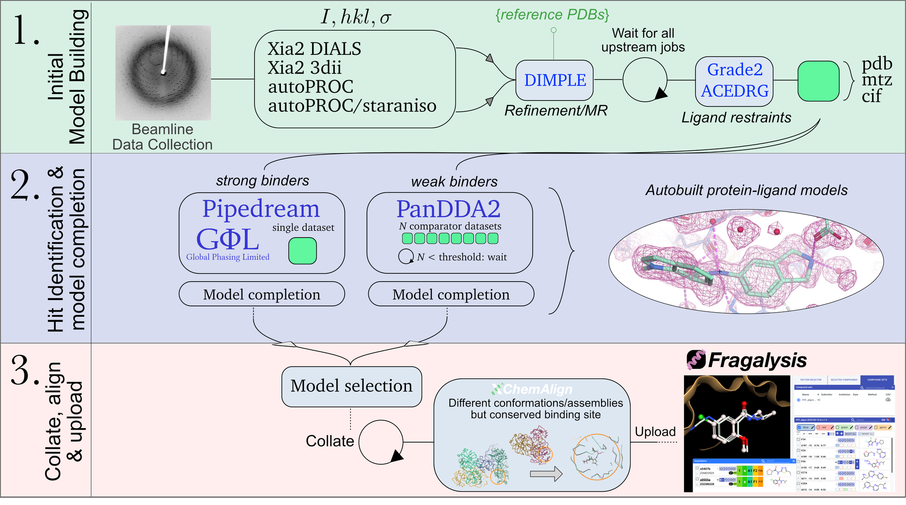

Workflow
===================================

   An overview of the Diff2IR pipeline - an automated workflow to go from diffraction images 
   to refined protein-ligand models in Fragalysis. The pipeline consists of three stages:
   **1.** Processing of diffraction and the building of an initial structural model. 
   **2.** Hit identification and model completion, tuned for both high and low occupancy binders. 
   **3.** Data collation, and selection of one structural model per sample. Alignment with XChemAlign
   and the upload of data to Fragalysis.

The beamline data collection of samples at DLS triggers a series of automated data
analysis pipelines. On successful completion, DIMPLE_ will attempt to provide an
initial structural model, using the set of uploaded user PDB structures as potential
reference structures. Conformational restraints describing the soaked ligand are also
generated in advance.

Two hit identification pipelines, PanDDA2_ and Pipedream_ (Global Phasing), are run in
parallel, suited to identifying low and high occupancy binders respectively. Whereas
Pipedream can run per single dataset, PanDDA2 is a statistical method that requires a
threshold of comparator datasets (N ~ 300) before it can run. Both pipelines include
automated ligand fitting. Weakly supported waters are removed and validation metrics computed.

A single protein-ligand model (if available) is taken forward for each sample and information
collated across all datasets. Models are aligned onto a common reference frame with
XChemAlign_, which aims to provide a clear picture of how fragments are likely to bind
relative to each other in biology, without crystallographic complications. The data
package is subsequently uploaded to the Fragalysis_ platform.

None of this requires user intervention: data collection alone is enough to start the
pipeline. Results appear under the labxchem visit directory under ``processed`` as they are produced.

.. _DIMPLE: https://ccp4.github.io/dimple/
.. _PanDDA2: https://github.com/xchem/PanDDA2
.. _Pipedream: https://www.globalphasing.com/buster/manual/pipedream/manual/
.. _XChemAlign: https://github.com/xchem/xchem-align
.. _Fragalysis: https://fragalysis.readthedocs.io/en/latest/index.html
.. _XChemExplorer: https://github.com/xchem/XChemExplorer
.. _ISPyB: https://ispyb.diamond.ac.uk

An optional configuration file ``.user.yaml`` in the top level labxchem visit directory
(e.g. ``/dls/labxchem/data/lb42888/lb42888-3``) can further specify any optional
parameters for the autoprocessing, e.g:

.. code-block:: yaml

   autoprocessing:
     pandda:
       high_res_lower_limit: 2.5
   data:
     acronym: XX01ZVNS2B

.. note::

   **Work in progress.** Currently the configuration file schema is quite limited in what it allows
   a user to change about how the data is processed with the auto pipeline, but 
   we are working on supporting enhanced customisation in the near future.

1. Initial Model Building
-------------------------

The aim of this first part of the pipeline is to turn diffraction images into an inital
structural model, a set of restraints to desctibe the soaked ligand, and to create a 
per-crystal directory in the model_building directory in the corresponding labxchem visit.

Data processing
~~~~~~~~~~~~~~~

Each data collection triggers the standard DLS autoprocessing pipelines, which run in
parallel and integrate and scale the images to produce a set of (``I``, ``hkl``, ``sigma``).

* **xia2 / DIALS**
* **xia2 / 3dii**
* **autoPROC**
* **autoPROC / STARANISO**

There is no need to choose between them in advance — all four are attempted (once in the
user defined spacegroup and again letting the pipeline determine the spacegroup).

Dataset selection
~~~~~~~~~~~~~~~~~

A crystal usually has several successful processing results, and may also have been
recollected. Diff2IR resolves this to one dataset before any further downstream processing:

* Results processed in the **user-defined spacegroup** are prioritised.
* Remaining candidates are ranked on a combination of **I/sigma(I)**, **completeness**
  and the **number of unique reflections** (same default setting as XChemExplorer_)
* Where data for a particular sample has been **recollected** or **reprocessed**, a result from the latest processing batch is taken forward.

Initial model with DIMPLE
~~~~~~~~~~~~~~~~~~~~~~~~~

The selected dataset is passed to DIMPLE_, which performs molecular replacement and
refinement against the set of **reference PDB structures uploaded by the user to ISPyB_ for the
visit**. The result is an initial model and map (``dimple.pdb`` / ``dimple.mtz``)
— used as input for downstream processing steps.

Providing a good set of reference models is the most direct way one can improve downstream results.

Ligand restraints
~~~~~~~~~~~~~~~~~

Alongside running DIMPLE_, conformational restraints for the soaked compound are
generated **up front**, before either hit identification pipeline starts:

* The compound SMILES for the crystal is read from **soakDB** and written to
  ``compound/<CompoundCode>.smiles``.
* A dedicated restraints job runs **Grade2** on that SMILES string, producing
  ``compound/<CompoundCode>.cif`` and ``compound/<CompoundCode>.pdb``, with a
  ``restraints.log`` alongside.

Generating restraints once as their own job (rather than inside each hit identification
pipeline) means PanDDA2 and Pipedream share exactly the same ligand description, and a
dataset is only considered ready for hit identification once its restraints exist on
disk.

.. note::

   A dataset with no SMILES in soakDB, or with more than one ``.smiles`` file in its
   ``compound`` directory, cannot have restraints generated and will not proceed to hit
   identification. Missing or ambiguous compound information in soakDB is the most
   common reason a crystal drops out of the pipeline at this point.

Output layout
~~~~~~~~~~~~~

This stage writes everything the downstream pipelines need into a single per-crystal
directory, keyed by ``dtag`` (the sample name)::

    <visit>/processed/auto/analysis/model_building/<dtag>/
        dimple.pdb                       # initial model from DIMPLE
        dimple.mtz                       # corresponding map coefficients
        <dtag>.free.mtz                  # reflections with free-R set
        compound/<CompoundCode>.smiles   # from soakDB
        compound/<CompoundCode>.cif      # ligand restraints
        compound/<CompoundCode>.pdb      # ligand ideal coordinates
        restraints.log                   # restraints log

Both PanDDA2 and Pipedream read from the same model_building directory.

2. Hit Identification and Model Completion
------------------------------------------

Two hit identification pipelines are run over the same prepared datasets:

Pipedream — high occupancy binders
~~~~~~~~~~~~~~~~~~~~~~~~~~~~~~~~~~

Pipedream_ (Global Phasing) works from a **single dataset**, so it runs as soon as the
ligand restraints are on disk. It refines the model, searches the difference density
for the ligand with rhofit, and post-refines the best solution.

Ligand fitting quality is reported as an **RSCC** taken from the rhofit correlation log,
i.e. the correlation computed *before* the ligand has been refined into the model. This
is effectively an omit-map correlation and is deliberately preferred over the
post-refinement number, which is inflated by model bias and is therefore a poorer
discriminator of whether the ligand is really there.

The RSCC drives the confidence recorded for the dataset:

* **RSCC >= 0.8** — high confidence; the dataset is marked ``4 - CompChem ready``.
* **RSCC >= 0.7** — weaker but supported; the dataset is marked ``3 - In Refinement``.

Outputs are written per crystal to ``<visit>/processed/auto/analysis/pipedream/<dtag>/``,
including the refined model, the rhofit solutions, and the Pipedream summary and report
HTML.

PanDDA2 — low occupancy binders
~~~~~~~~~~~~~~~~~~~~~~~~~~~~~~~

PanDDA2_ finds the weak, partial-occupancy binding events that are not seen in a
conventional difference map. It does this **statistically**, by building ground-state
models of the density from many comparator datasets and looking for what deviates from
it.

A visit therefore needs to accumulate datasets in the model_building directory before PanDDA2 can
begin and is tr

* **Below the comparator threshold** (N ~ 300 datasets, configurable per visit) PanDDA2
  is skipped and the dataset simply waits.
* **On reaching the threshold**, PanDDA2 is launched over the datasets collected so far.
* **Above the threshold**, each dataset that arrives after the threshold is analysed as it arrives.

Events are autobuilt with using the ligand restraints and scored, with the best scoring
dataset retained. To make results browsable by quality, datasets are also symlinked
into score bands under ``<visit>/processed/auto/analysis/pandda2/score_<lo>-<hi>/``,
each band carrying its own filtered copy of the PanDDA event and site tables for easier navigation.

Outputs live under ``<visit>/processed/auto/analysis/pandda2/panddas/``, with the
per-dataset results in ``processed_datasets/<dtag>/``.

Model completion
~~~~~~~~~~~~~~~~

.. note::

   **Work in progress.** Removal of weakly supported waters and the additional
   refinement and validation steps shown in the figure are not yet implemented in the
   automated pipeline. See :doc:`water_completion`,
   :doc:`low_occupancy_model_completion` and :doc:`high_occupancy_model_completion`.

3. Collate, Align and Upload
----------------------------

The final stage runs once the hit identification jobs for a visit have finished. It
reduces the two parallel sets of results to one model per crystal and prepares them into a
data package that can be uploaded to Fragalysis_.

Model selection
~~~~~~~~~~~~~~~

Every dataset is processed by every available pipeline, so a crystal can end up with a
Pipedream model, a PanDDA2 model, both, or neither. One is chosen per crystal — the
heuristics for this process are given in :doc:`model_selection`.

Collation
~~~~~~~~~

The selected models and their metrics are collated across the whole visit:

* **soakDB is updated** with the outcome for each crystal (for example
  ``4 - CompChem ready`` or ``3 - In Refinement``), along with the ligand confidence and
  refinement statistics. Rows that a person has already curated are not overwritten by
  the automation.
* Per-visit **summary tables and html reports** are written, and the PanDDA score-band
  directories are refreshed so results can be browsed by quality.

Alignment with XChemAlign
~~~~~~~~~~~~~~~~~~~~~~~~~

XChemAlign_ places all results in a **common reference frame** based on the
conserved binding site(s), such that ligands can be compared directly with each other —
the question of interest being how they bind in biology, not how the crystal happened to
pack. If a user has placed an assemblies.yaml file in the usual location, XCA will run and
the output written to ``<visit>/processed/analysis/xchemalign/``.

.. note::

   This feature is currently under active development.

Upload to Fragalysis
~~~~~~~~~~~~~~~~~~~~

The aligned package is tarred and uploaded to the Fragalysis_ 
platform, where users can view the ensemble of bound-state models, inspect density, and
begin compound design and elaboration. The target is identified by the visit, so results
appear under the proposal the data were collected on.

.. note::

   Uploads currently go to the Fragalysis **staging** deployment while the pipeline is
   being validated. A visit's results are only visible to accounts that are members of
   the corresponding proposal.

.. note::

   **Work in progress.** An automatic notification to the visit's team leader on
   completion of collation is implemented but still in testing. 

PanDDA2 mtz map conversion
~~~~~~~~~~~~~~~~~~~~~~~~~~

Sometimes maps will appear misaligned with the model in Fragalysis. 

To fix this, once you have copied over the event maps from the PanDDA run to the respective model building directory, you can run the following script:

cd /dls_sw/i04-1/software/PanDDA2
source ./venv/bin/activate
python scripts/event_map_to_mtz.py event_maps_to_mtz {pandda_path} {model_building_dir_path}
